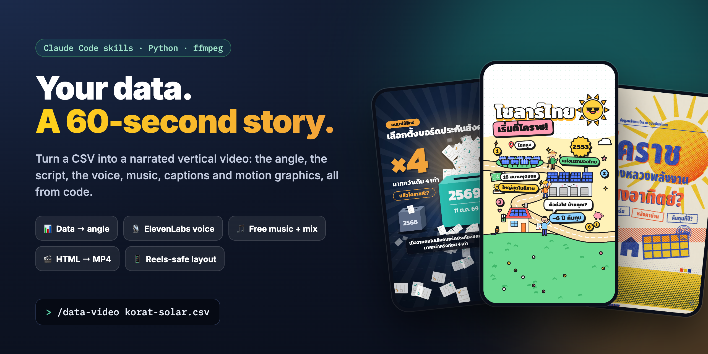
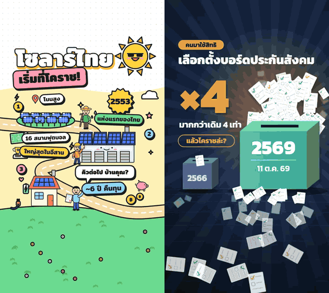
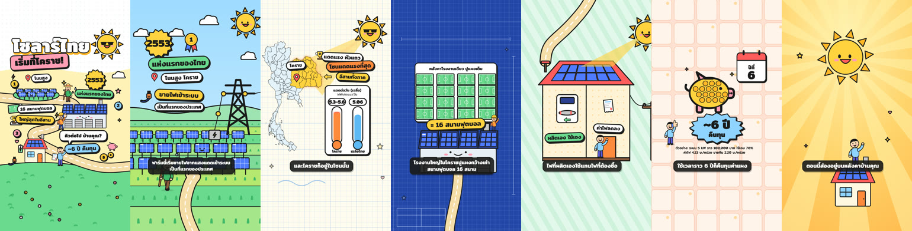

<div align="center">



# data-video-kit

**Your data. A 60-second story.**

Claude Code skills and small Python scripts that turn a spreadsheet into a narrated vertical
video for Reels, TikTok and Shorts. It finds the angle, writes the script, voices it, mixes
music and sound effects, and renders motion graphics from HTML, all from code.


[What you get](#-what-you-get) · [See it](#-see-it-in-action) · [Quick start](#-quick-start) · [Pipeline](docs/PIPELINE.md) · [Voice guide](docs/VOICE.md) · [ภาษาไทย](#-ภาษาไทย)

</div>

## ✨ What you get

| Feature | What it does |
|---|---|
| 📊 **Data → angle** | The `data-video` skill recomputes every number, pairs your data with a second public dataset, and writes three angles before one script. The value is the interpretation, not a reading of the table. |
| 🪝 **Hooks that land in 3 s** | Verdict-first openers, a question answered by second 5, a full-bleed frame-1 poster, and story shapes that rotate across a series (logged in `series-log.md`). |
| ✍️ **Script lint** | `mv-script-lint.py` flags too many numbers per minute, weak openers, overused "แต่", words the voice mispronounces, and dashes. |
| 🎙️ **ElevenLabs narration** | Key pool rotated by balance, a spend ledger (the balance API lags), a content cache so unchanged lines are free, audio tags, a dry run, and a backup voice. |
| 🆓 **Free placeholder voice** | macOS `say` / `espeak-ng` / silence, so you can time, mix and render everything before paying for a single character. |
| ⏱️ **Captions from real pauses** | `mv-timeline.py` measures each clip and writes `timeline.json` + `.srt` with caption breaks on the actual breaths. |
| 🎵 **Music and mix** | Procedural music (no licence questions), sidechain ducking under the voice, sound effects at the animation cues, -16 LUFS. |
| 🎬 **HTML → MP4** | Any page with `window.render(t)` becomes a video through Playwright + ffmpeg. Two full templates and one cover sample included. |
| 📱 **Reels-safe layout** | A safe-area contract measured from real phones, and an overlay that paints what the app UI covers. |

## 🎬 See it in action

<div align="center">


<sub>The first 10 seconds of two videos made with this workflow from Thai public data (left: `line-cartoon`, right: `civic-poster`).</sub>
</div>

Every scene of the solar video, from the template you can re-time with your own narration:



## 🚀 Quick start

You need [Claude Code](https://claude.com/claude-code), Python 3.9+, ffmpeg, and Playwright with Chromium.

```bash
git clone https://github.com/tlejay/data-video-kit.git
cd data-video-kit
claude
```

1. **Set up:** type `/kiki-init`. It checks and installs the prerequisites (macOS, Linux,
   WSL), links the skills into `~/.claude/skills`, sets your ElevenLabs key and voice in
   `.env` (never echoed, never committed), picks a default template and music mood, and runs
   a free smoke test with a pass/fail line per step.
2. **Try the free example:** `bash examples/korat-solar/run.sh --full` renders a complete
   video with placeholder narration. No API key needed.
3. **Make your first video:** `/data-video your-data.csv`

<details>
<summary>Manual install (without /kiki-init)</summary>

```bash
# macOS
brew install python ffmpeg
# Debian/Ubuntu/WSL
sudo apt install -y python3 python3-pip ffmpeg espeak-ng

python3 -m pip install -r requirements.txt
python3 -m playwright install chromium        # Linux: add --with-deps
bash install.sh                                # links skills into ~/.claude/skills
export DATA_VIDEO_KIT="$PWD"                   # add to ~/.zshrc or ~/.bashrc
cp .env.example .env                           # then fill in the voice values
python3 scripts/kit-doctor.py --smoke          # free end-to-end check
```
</details>

## 🧭 How it works

```
CSV ─► angle ─► hooks ─► script ─► lint ─► (approve) ─► voice ─► timeline.json + .srt
                                                                   │
                                 music ─► mix ◄────────────────────┤
                                                                   ▼
        template ─► 3 frame-1 posters ─► visual build ─► stills review ─► render ─► MP4 + SRT
```

Two skills split the job. **`data-video`** is the story layer: data, angle, hooks, script,
review, and when to spend money. **`motion-video`** is the production layer: voice, timing,
HTML frames, mix and render. Inside Claude Code the lead session keeps the angle, script and
review, fans research out to parallel subagents, and hands the HTML motion build to the
strongest model as a background agent. Every rule carries a `[rule]` or `[trial]` label,
and three evals in `skills/data-video/evals/` keep changes to the rules honest.

Step-by-step commands: [`docs/PIPELINE.md`](docs/PIPELINE.md).

## 🎙️ Voice

Only narration costs money. Put `ELEVENLABS_API_KEY` (or a comma-separated
`ELEVENLABS_API_KEYS` pool) and `ELEVENLABS_VOICE_ID` in `.env`; any voice works. Then:

```bash
python3 scripts/tts-clip.py --dir work --dry-run   # characters and cost, no call
python3 scripts/tts-quota.py --need 900            # does ONE key have room? (free)
python3 scripts/tts-clip.py --dir work             # voice every tN.txt
```

Settings, Thai pronunciation fixes, audio tags, caching, quota traps and the backup voice:
[`docs/VOICE.md`](docs/VOICE.md) and [`docs/voice-audio-tags.md`](docs/voice-audio-tags.md).

## 📁 Layout

| Path | What |
|---|---|
| `skills/data-video/` | the story skill: `SKILL.md`, `references/` (one file per step, with the lessons behind each rule), `evals/` |
| `skills/motion-video/` | the production skill + a worked HTML example |
| `skills/kiki-init/` | interactive first-run setup |
| `scripts/` | `mv-*` (lint, timeline, music, mix, render, safe zone, audio analysis), `tts-*` (voice), `placeholder-voice.py`, `kit-doctor.py`, `set-env.py` |
| `templates/` | `line-cartoon`, `civic-poster` (full videos), `risograph-sample` (cover) |
| `sfx/` | burst, whoosh, highlight, pop, end |
| `examples/korat-solar/` | script, captions, facts with sources, and a one-command free render |
| `docs/` | `PIPELINE.md`, `VOICE.md`, `voice-audio-tags.md` |

Every script has `--help`. `.claude/skills/` links the skills so they also work when Claude
Code runs inside this folder without installing anything.

## 🔒 Privacy and cost

- Keys live only in `.env` (git-ignored) or your environment; scripts show keys as `key1`,
  `key2`, never their values.
- No script calls a paid API unless you run `tts-clip.py` / `tts-cached.py` without
  `--dry-run`. Everything else is local.
- The skill never publishes anything; you deliver the MP4 and SRT yourself.

## 🇹🇭 ภาษาไทย

ชุดเครื่องมือสำหรับครีเอเตอร์ที่อยากเปลี่ยน "ข้อมูลดิบ" (CSV, ชีต, สถิติราชการ) ให้เป็นคลิปแนวตั้ง
60 วินาทีที่มีเสียงบรรยาย ซับไตเติล เพลง และโมชันกราฟิก ทำงานผ่าน Claude Code

- **เริ่มต้น:** clone แล้วเปิด `claude` ในโฟลเดอร์ จากนั้นพิมพ์ `/kiki-init` ระบบจะเช็คและติดตั้งสิ่งที่ต้องใช้
  ตั้งค่าคีย์ ElevenLabs ใน `.env` (ไม่แสดงคีย์ ไม่ commit) แล้วทดสอบทั้งสายแบบไม่เสียเงิน
- **ลองฟรีก่อน:** `bash examples/korat-solar/run.sh --full` เรนเดอร์คลิปตัวอย่างเต็มด้วยเสียงชั่วคราว (macOS `say`)
- **ทำคลิปแรก:** `/data-video ไฟล์ของคุณ.csv` หรือแค่บอกหัวข้อ เช่น "อยากทำวิดีโอเรื่องข้าวในประเทศไทย" ระบบจะหาข้อมูลจากแหล่งทางการให้ก่อน พร้อมที่มาทุกตัวเลข
- **หัวใจของสกิล:** ไม่ใช่การอ่านตาราง แต่คือการตีความข้อมูลจากมุมของคนดู คำตอบต้องมาภายใน 3 วินาทีแรก
  ตัวเลขน้อยแต่จับต้องได้ ทุกตัวเลขคำนวณใหม่จากข้อมูลจริง และอ้างอิงแหล่งที่มาเสมอ
- **เสียง:** ส่วนเดียวที่เสียเงินคือเสียงบรรยาย สคริปต์จะตรวจคำที่เสียงอ่านเพี้ยน (เช่น "บก") และให้ทดลองด้วยเสียงฟรีก่อนทุกครั้ง
  รายละเอียดใน [`docs/VOICE.md`](docs/VOICE.md)

## 🤝 Contributing

Issues and pull requests are welcome: new templates (with their sticker kit and a README of
the data contract), new entries for the mispronunciation table, data recipes for other
countries, and eval runs. Keep scripts dependency-light and runnable with `--help`.

## License

[MIT](LICENSE). Example data and on-screen facts come from public Thai sources cited in
`examples/korat-solar/facts.csv` and on each template's end card; map geometry is
geoBoundaries (CC BY 3.0 IGO).

<div align="center"><sub>If this saved you an evening of editing, a ⭐ helps others find it.</sub></div>
