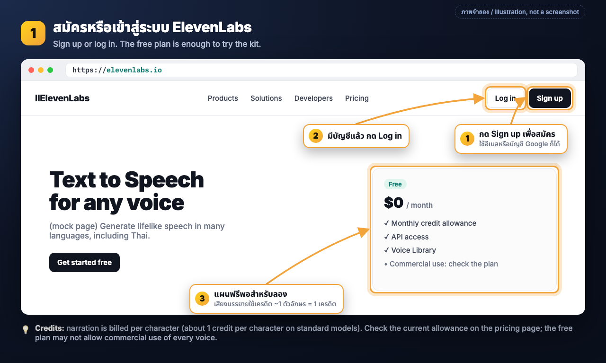
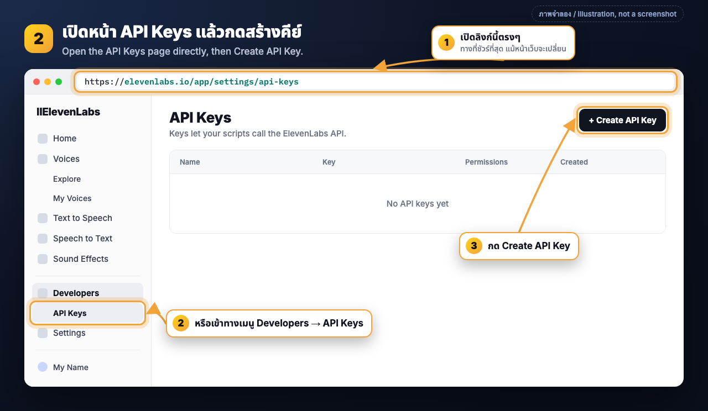
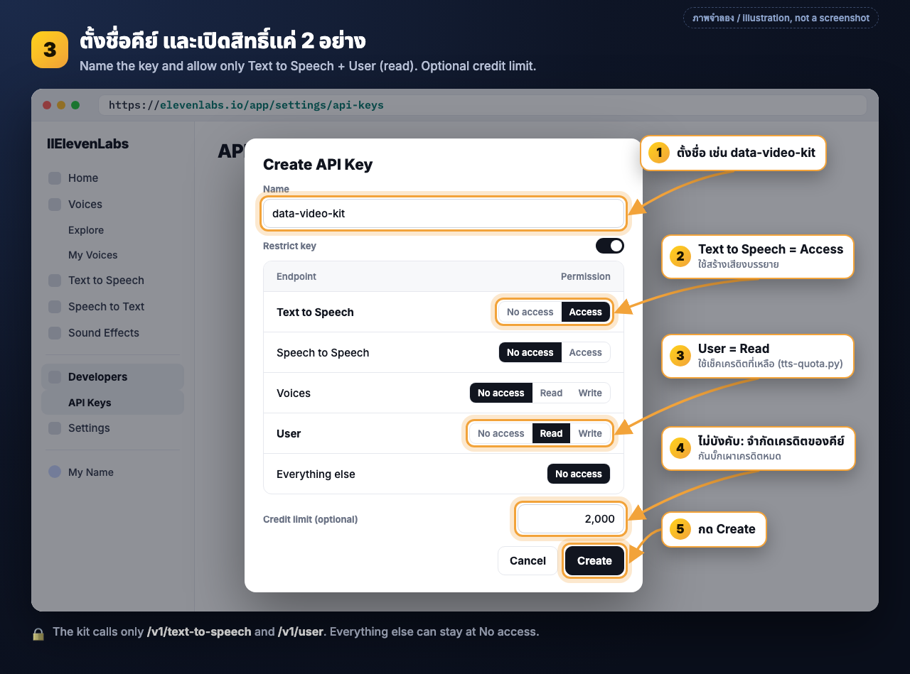
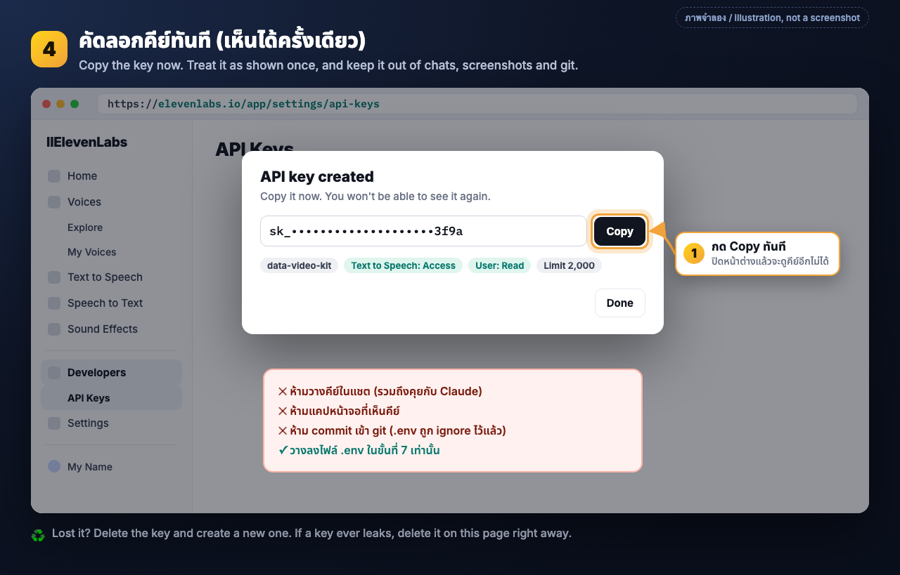
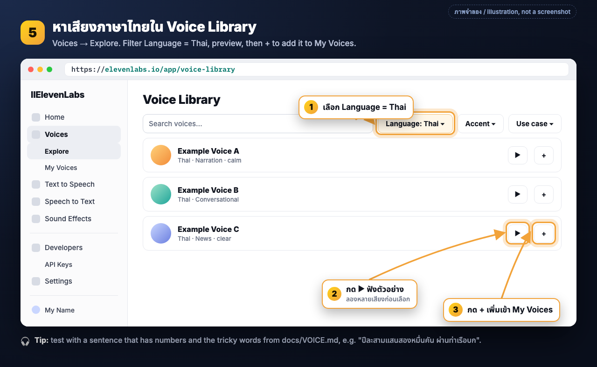
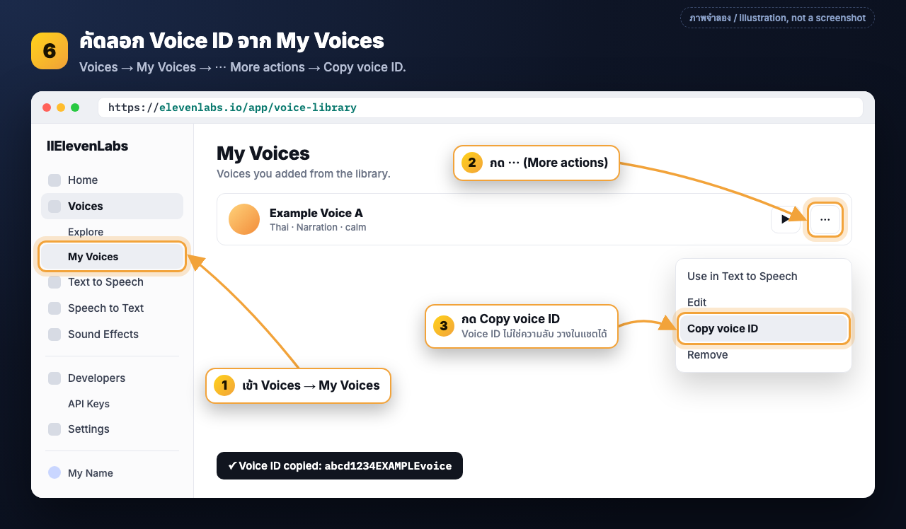
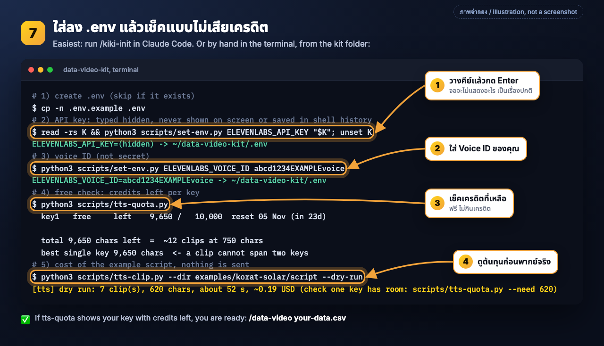

# ElevenLabs setup: API key + voice ID

[ภาษาไทย](#ภาษาไทย) · [English](#english)

> หมายเหตุ / Note: ชื่อปุ่มบนเว็บ ElevenLabs เปลี่ยนเป็นระยะ ลิงก์ตรงด้านล่างคือทางที่เชื่อถือได้ที่สุด
> (ตรวจกับเอกสารของ ElevenLabs เดือนตุลาคม 2026). Button labels on ElevenLabs change from time to
> time; the direct links are the reliable path (checked against their docs, October 2026).
> ภาพทั้งหมดเป็นภาพจำลอง ไม่ใช่ภาพหน้าจอจริง / All images are illustrations, not screenshots.

---

## ภาษาไทย

kit นี้ใช้ ElevenLabs แค่ขั้นเดียวคือ **เสียงบรรยาย** ซึ่งเป็นส่วนเดียวที่เสียเงิน ที่เหลือฟรีและรันบนเครื่องเราเองทั้งหมด
ถ้ายังไม่พร้อมสมัคร ก็ลองทั้งสายได้ด้วยเสียงชั่วคราวฟรี (`bash examples/korat-solar/run.sh --full`)

สิ่งที่ต้องได้จากคู่มือนี้มีสองอย่าง: **API key** (ความลับ) และ **Voice ID** (ไม่ใช่ความลับ)

### 1. สมัครหรือเข้าสู่ระบบ

เปิด https://elevenlabs.io แล้วกด **Sign up** (หรือ **Log in** ถ้ามีบัญชีแล้ว)



- แผนฟรีพอสำหรับลองใช้ มีเครดิตให้ทุกเดือน
- เสียงบรรยายคิดเงินเป็นเครดิต ประมาณ **1 ตัวอักษร = 1 เครดิต** บนโมเดลมาตรฐาน คลิป 60 วินาทีภาษาไทยใช้ราว 700 ถึง 800 ตัวอักษร
  ดูจำนวนเครดิตล่าสุดที่หน้า https://elevenlabs.io/pricing
- แผนฟรีอาจ **ไม่อนุญาตให้ใช้บางเสียงในงานเชิงพาณิชย์** ถ้าจะลงคลิปในเพจธุรกิจ ให้เช็คเงื่อนไขของแผนและของเสียงนั้นก่อน

### 2. เปิดหน้า API Keys แล้วกดสร้างคีย์

เปิดลิงก์ตรง: **https://elevenlabs.io/app/settings/api-keys**
(หรือเข้าทางเมนูด้านซ้าย **Developers** หรือ **Settings → API Keys**) แล้วกด **Create API Key**



### 3. ตั้งชื่อคีย์ และเปิดสิทธิ์แค่ 2 อย่าง

- **Name:** ตั้งชื่อที่จำได้ เช่น `data-video-kit`
- คีย์ใหม่ถูกจำกัดสิทธิ์ (restricted) ไว้ก่อน ให้เปิดแค่สองอย่างที่ kit ใช้จริง:
  - **Text to Speech → Access** สำหรับสร้างเสียง (`/v1/text-to-speech`)
  - **User → Read** สำหรับเช็คเครดิตที่เหลือ (`/v1/user`, ใช้โดย `tts-quota.py`)
  - อย่างอื่นปล่อยเป็น No access
- **Credit limit (ไม่บังคับแต่แนะนำ):** จำกัดเครดิตของคีย์นี้ เช่น 2,000 เผื่อสคริปต์มีบั๊กจะได้ไม่เผาเครดิตทั้งบัญชี
- กด **Create**



### 4. คัดลอกคีย์ทันที

กด **Copy** ตอนนั้นเลย ให้ถือว่า **เห็นคีย์ได้ครั้งเดียว** ปิดหน้าต่างแล้วจะดูอีกไม่ได้ (ถ้าทำหาย ให้ลบคีย์แล้วสร้างใหม่)



**ห้าม** วางคีย์ในแชต (รวมถึงคุยกับ Claude) **ห้าม** แคปหน้าจอที่เห็นคีย์ **ห้าม** commit เข้า git
ที่เดียวที่คีย์ควรอยู่คือไฟล์ `.env` ในขั้นที่ 7 (ไฟล์นี้ถูก git ignore ไว้แล้ว) ถ้าคีย์หลุด ให้ลบที่หน้า API Keys ทันที

### 5. หาเสียงภาษาไทยใน Voice Library

เมนู **Voices → Explore** หรือลิงก์ตรง **https://elevenlabs.io/app/voice-library**

1. ตั้งตัวกรอง **Language = Thai**
2. กด ▶ ฟังตัวอย่างหลายๆ เสียง
3. ชอบเสียงไหน กด **+** เพื่อเพิ่มเข้า **My Voices**



**เคล็ดลับ:** ลองหลายเสียงด้วยประโยคที่มีตัวเลขและคำที่เสียงมักอ่านเพี้ยน (ดูตารางท้าย [`VOICE.md`](VOICE.md))
เช่น "ปีละสามแสนสองหมื่นคัน ผ่านท่าเรือบก" เสียงที่อ่านตัวเลขไทยลื่นและวรรณยุกต์ถูก คือเสียงที่ควรเลือก

### 6. คัดลอก Voice ID

ไปที่ **Voices → My Voices** หาเสียงที่เพิ่มไว้ กด **⋯ (More actions) → Copy voice ID**



Voice ID ไม่ใช่ความลับ วางในแชตหรือส่งให้เพื่อนได้

### 7. ใส่ลง `.env` แล้วเช็คแบบไม่เสียเครดิต

**ง่ายที่สุด:** เปิด Claude Code ในโฟลเดอร์ kit แล้วพิมพ์ `/kiki-init` ระบบจะถามแล้วเขียน `.env` ให้โดยไม่แสดงคีย์

**หรือทำเองในเทอร์มินัล** (รันจากโฟลเดอร์ kit):

```bash
cp -n .env.example .env                       # สร้าง .env (มีแล้วจะข้าม)

# API key: พิมพ์/วางแบบซ่อน ไม่ขึ้นจอและไม่ติดใน shell history แล้วกด Enter
read -rs K && python3 scripts/set-env.py ELEVENLABS_API_KEY "$K"; unset K

# Voice ID (ไม่ใช่ความลับ)
python3 scripts/set-env.py ELEVENLABS_VOICE_ID <voice id ของคุณ>

# เช็คฟรี: เครดิตที่เหลือของแต่ละคีย์ (ไม่กินเครดิต)
python3 scripts/tts-quota.py

# ดูต้นทุนของสคริปต์ตัวอย่าง ไม่ส่งอะไรออกไป
python3 scripts/tts-clip.py --dir examples/korat-solar/script --dry-run
```

หรือจะเปิดไฟล์ `.env` ด้วย editor แล้วกรอก `ELEVENLABS_API_KEY=` กับ `ELEVENLABS_VOICE_ID=` เองก็ได้



ถ้า `tts-quota.py` แสดงคีย์ของคุณพร้อมเครดิตที่เหลือ แปลว่าพร้อมแล้ว: `/data-video ไฟล์ของคุณ.csv`

### 8. แก้ปัญหา

| อาการ | สาเหตุที่พบบ่อย | วิธีแก้ |
|---|---|---|
| `401` / `invalid_api_key` | คีย์ผิด คัดลอกไม่ครบ หรือคีย์ถูกลบแล้ว | สร้างคีย์ใหม่ (ขั้นที่ 2 ถึง 4) แล้วใส่ `.env` ใหม่ |
| `401` ตอนเช็คเครดิต (`tts-quota.py` ขึ้น unusable) | คีย์ไม่ได้เปิดสิทธิ์ **User → Read** | แก้สิทธิ์คีย์ที่หน้า API Keys |
| `401` ตอนสร้างเสียง แต่ quota ปกติ | ไม่ได้เปิด **Text to Speech → Access** หรือเครดิตในคีย์ไม่พอสำหรับคลิปนี้ | เปิดสิทธิ์ หรือเพิ่ม credit limit ของคีย์ |
| `403` / หาเสียงไม่เจอ | เสียงยังไม่ได้อยู่ใน **My Voices** หรือแผนปัจจุบันใช้เสียงนี้ผ่าน API ไม่ได้ | กด + เพิ่มเสียง (ขั้นที่ 5) หรือเลือกเสียงอื่น |
| `quota_exceeded` | เครดิตของเดือนหมด หรือคีย์ไหนก็ไม่มีพอสำหรับคลิปนี้ | รอรอบรีเซ็ต อัปเกรดแผน หรือใช้หลายคีย์ (ด้านล่าง) |
| สคริปต์บอก `ELEVENLABS_VOICE_ID is not set` | ยังไม่ได้ใส่ Voice ID | ขั้นที่ 6 และ 7 |

**ใช้หลายคีย์:** ใส่ใน `.env` เป็น `ELEVENLABS_API_KEYS=key1,key2,key3` (คั่นด้วยจุลภาค) สคริปต์จะเลือกคีย์ที่มีเครดิตพอสำหรับคลิปนั้นเอง
แต่ **หนึ่งคลิปใช้ได้คีย์เดียว** จึงต้องดูเครดิตของคีย์ที่เหลือมากที่สุด ไม่ใช่ผลรวม (`tts-quota.py --need 900`)
รายละเอียดเรื่องเครดิต การ cache และคำที่อ่านเพี้ยน: [`VOICE.md`](VOICE.md)

---

## English

The kit uses ElevenLabs for one step only, **narration**, which is the only paid part. Everything
else is free and local. Not ready to sign up? Run the whole pipeline with free placeholder voice:
`bash examples/korat-solar/run.sh --full`.

You need two things: an **API key** (secret) and a **voice ID** (not secret). The step images
are in the Thai section above; the numbers match.

### 1. Sign up or log in

Open https://elevenlabs.io and click **Sign up** (or **Log in**).

- The free plan is enough to try the kit; it comes with a monthly credit allowance.
- Narration is billed in credits, about **1 credit per character** on standard models. A 60 s Thai
  narration is roughly 700 to 800 characters. Current numbers: https://elevenlabs.io/pricing
- The free plan **may not allow commercial use** of every voice. Check the plan and the voice's
  terms before publishing on a business page.

### 2. Open the API Keys page

Direct link: **https://elevenlabs.io/app/settings/api-keys** (also in the sidebar under
**Developers** or **Settings → API Keys**). Click **Create API Key**.

### 3. Name it and allow only two permissions

- **Name:** something you will recognise, e.g. `data-video-kit`.
- Keys are restricted by default. Enable only what the kit calls:
  - **Text to Speech → Access** (`/v1/text-to-speech`, renders the narration)
  - **User → Read** (`/v1/user`, the free credit check in `tts-quota.py`)
  - leave everything else at No access.
- **Credit limit (optional, recommended):** cap the key, e.g. 2,000 credits, so a bug cannot burn the
  whole balance.
- Click **Create**.

### 4. Copy the key immediately

Click **Copy** right away and treat the key as **shown once** (lost it? delete it and create a new
one). **Never** paste it into a chat (including Claude), a screenshot, or git. Its only home is `.env`
(step 7), which is git-ignored. If a key leaks, delete it on the API Keys page at once.

### 5. Find a Thai voice

**Voices → Explore**, or **https://elevenlabs.io/app/voice-library**. Set **Language = Thai**,
preview with ▶, and click **+** to add a voice to **My Voices**.

**Tip:** compare several voices with a sentence that has numbers and the words listed in the
mispronunciation table of [`VOICE.md`](VOICE.md), e.g. "ปีละสามแสนสองหมื่นคัน ผ่านท่าเรือบก". Pick the
one that reads Thai numbers smoothly with the right tones.

### 6. Copy the voice ID

**Voices → My Voices**, then on your voice **⋯ (More actions) → Copy voice ID**. The voice ID is not
a secret.

### 7. Put both in `.env` and check for free

Easiest: run `/kiki-init` in Claude Code inside the kit folder; it asks and writes `.env` without
echoing the key. By hand, from the kit folder:

```bash
cp -n .env.example .env
read -rs K && python3 scripts/set-env.py ELEVENLABS_API_KEY "$K"; unset K   # paste, Enter; nothing is shown
python3 scripts/set-env.py ELEVENLABS_VOICE_ID <your voice id>
python3 scripts/tts-quota.py                                                   # credits left per key (free)
python3 scripts/tts-clip.py --dir examples/korat-solar/script --dry-run       # cost, nothing is sent
```

Or open `.env` in an editor and fill `ELEVENLABS_API_KEY=` and `ELEVENLABS_VOICE_ID=`. When
`tts-quota.py` lists your key with credits left, you are ready: `/data-video your-data.csv`.

### 8. Troubleshooting

| Symptom | Usual cause | Fix |
|---|---|---|
| `401` / `invalid_api_key` | wrong or truncated key, or the key was deleted | create a new key (steps 2 to 4) and set it again |
| `401` on the credit check (`tts-quota.py` says unusable) | the key lacks **User → Read** | edit the key's permissions |
| `401` when rendering while the quota looks fine | **Text to Speech → Access** missing, or the key's credit limit is lower than this clip | enable it, or raise the key's limit |
| `403` / voice not found | the voice is not in **My Voices**, or your plan cannot use it through the API | add it with + (step 5) or pick another voice |
| `quota_exceeded` | monthly credits used up, or no key has room for this clip | wait for the reset, upgrade, or add keys (below) |
| `ELEVENLABS_VOICE_ID is not set` | voice ID missing | steps 6 and 7 |

**Several keys:** `ELEVENLABS_API_KEYS=key1,key2,key3` in `.env`. The scripts pick a key with room for
each clip, but **one clip renders on one key**, so what matters is the best single key, not the sum
(`tts-quota.py --need 900`). Credits, caching and pronunciation: [`VOICE.md`](VOICE.md).

Images are rebuilt from `docs/media/elevenlabs/src/*.html` with
`python3 docs/media/elevenlabs/src/build.py`.
